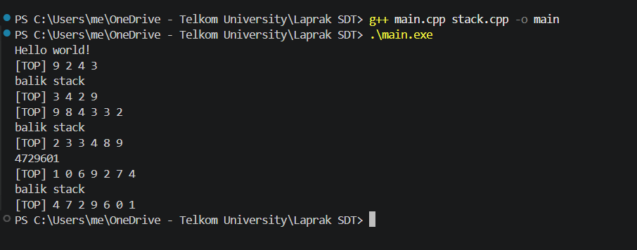

# <h1 align="center">Laporan Praktikum Modul 7 - Stack</h1>
<p align="center">Ignatius Steven Manurung - 109082500089</p>

## Dasar Teori
Stack merupakan salah satu bentuk struktur data yang menerapkan prinsip operasi layaknya sebuah tumpukan, di mana elemen yang dapat diakses atau diambil terlebih dahulu adalah elemen yang berada pada posisi paling atas dengan prinsip LIFO (Last In First Out). Komponen penyusun pada stack pada dasarnya menyerupai singly linked list, tetapi seluruh akses data hanya dibatasi melalui satu penunjuk utama di bagian awal tumpukan yang dinamakan Top. Operasi fundamental pada struktur data ini terdiri atas Push untuk menyisipkan elemen baru ke posisi teratas tumpukan serta Pop untuk mengambil dan menghapus elemen yang berada pada posisi teratas tersebut.

Selain menggunakan pointer, stack juga dapat diimplementasikan menggunakan representasi tabel atau array berindeks yang memiliki kapasitas tumpukan terbatas dan tidak memerlukan manajemen memori dinamis seperti proses alokasi maupun dealokasi. Pada representasi array, kondisi stack kosong ditandai oleh nilai indeks awal pada penunjuk Top, dan setiap kali operasi Push dijalankan maka indeks Top akan bertambah satu sebelum menyimpan elemen baru ke dalam array. Sebaliknya, ketika operasi Pop dilakukan, data pada posisi indeks Top saat ini akan diambil terlebih dahulu lalu nilai indeks Top dikurangi satu sehingga penunjuk puncak bergeser ke elemen di bawahnya. 

## Unguided 

### 1. Buatlah ADT Stack menggunakan ARRAY sebagai berikut di dalam file “stack.h” dan implementasi ADT Stack menggunakan Array pada file “stack.cpp” dan “main.cpp” 

```C++
#ifndef STACK_H
#define STACK_H

#include <iostream>
using namespace std;

typedef int infotype;

struct Stack {
    infotype info[20];
    int top;
};

void createStack(Stack &S);
bool isEmpty(Stack S);
bool isFull(Stack S);
void push(Stack &S, infotype x);
infotype pop(Stack &S);
void printInfo(Stack S);
void balikStack(Stack &S);
void pushAscending(Stack &S, int x);
void getInputStream(Stack &S);

#endif
```
### Output Unguided 1 :

##### Output 1


Program mengimplementasikan ADT Stack menggunakan array berkapasitas 20 elemen beserta operasi dasarnya seperti createStack, push, pop, printInfo, dan balikStack. Operasi push dan pop bekerja dengan prinsip LIFO (Last In First Out) yang hanya memanipulasi elemen paling atas (TOP), sedangkan balikStack memindahkan seluruh isi stack ke stack sementara untuk membalik urutannya sehingga keluaran [TOP] 9 2 4 3 berubah menjadi [TOP] 3 4 2 9.

### 2. Tambahkan prosedur pushAscending( in/out S : Stack, in x : integer) 

```C++
#include "stack.h"

void createStack(Stack &S) {
    S.top = -1;
}

bool isEmpty(Stack S) {
    return S.top == -1;
}

bool isFull(Stack S) {
    return S.top == 19;
}

void push(Stack &S, infotype x) {
    if (!isFull(S)) {
        S.top++;
        S.info[S.top] = x;
    }
}

infotype pop(Stack &S) {
    infotype x = -1;
    if (!isEmpty(S)) {
        x = S.info[S.top];
        S.top--;
    }
    return x;
}

void printInfo(Stack S) {
    cout << "[TOP] ";
    for (int i = S.top; i >= 0; i--) {
        cout << S.info[i];
        if (i > 0) {
            cout << " ";
        }
    }
    cout << endl;
}

void balikStack(Stack &S) {
    Stack temp;
    createStack(temp);
    while (!isEmpty(S)) {
        push(temp, pop(S));
    }
    S = temp;
}

void pushAscending(Stack &S, int x) {
    Stack temp;
    createStack(temp);
    while (!isEmpty(S) && S.info[S.top] > x) {
        push(temp, pop(S));
    }
    push(S, x);
    while (!isEmpty(temp)) {
        push(S, pop(temp));
    }
}

void getInputStream(Stack &S) {
    char c = cin.get();
    while (c != '\n') {
        if (c >= '0' && c <= '9') {
            push(S, c - '0');
        }
        c = cin.get();
    }
}
```
### Output Unguided 2 :

##### Output 1


Prosedur pushAscending ditambahkan untuk memastikan setiap elemen baru disisipkan secara terurut sehingga nilai terbesar selalu berada di posisi TOP dan nilai terkecil berada di dasar stack. Jika angka baru yang masuk lebih kecil daripada elemen yang ada di TOP, elemen-elemen yang lebih besar tersebut akan dikeluarkan sementara ke stack bantuan sebelum angka baru dimasukkan, lalu dikembalikan lagi sehingga membentuk susunan [TOP] 9 8 4 3 3 2.

### 3. Tambahkan prosedur getInputStream( in/out S : Stack )

```C++
#include "stack.h"

int main() {
    cout << "Hello world!" << endl;
    Stack S;

    createStack(S);
    push(S, 3);
    push(S, 4);
    push(S, 8);
    pop(S);
    push(S, 2);
    push(S, 3);
    pop(S);
    push(S, 9);
    printInfo(S);
    cout << "balik stack" << endl;
    balikStack(S);
    printInfo(S);

    createStack(S);
    pushAscending(S, 3);
    pushAscending(S, 4);
    pushAscending(S, 8);
    pushAscending(S, 2);
    pushAscending(S, 3);
    pushAscending(S, 9);
    printInfo(S);
    cout << "balik stack" << endl;
    balikStack(S);
    printInfo(S);

    createStack(S);
    getInputStream(S);
    printInfo(S);
    cout << "balik stack" << endl;
    balikStack(S);
    printInfo(S);

    return 0;
}
```
### Output Unguided 3 :

##### Output 1


Prosedur getInputStream bertugas membaca masukan pengguna karakter demi karakter menggunakan cin.get() secara terus-menerus hingga tombol Enter ditekan. Setiap karakter angka yang terbaca langsung diubah menjadi bilangan bulat dan dimasukkan ke dalam stack menggunakan push, sehingga digit terakhir yang diketik pengguna otomatis menempati posisi TOP dan menghasilkan urutan [TOP] 1 0 6 9 2 7 4.

## Kesimpulan
Berdasarkan praktikum yang telah dilakukan, dapat disimpulkan bahwa stack merupakan struktur data linear berbasis prinsip LIFO (Last In First Out) di mana seluruh operasi penyisipan (push) dan pengambilan (pop) data hanya berpusat pada satu titik akses teratas yaitu Top. Implementasi stack menggunakan representasi array memungkinkan pengelolaan tumpukan data berkapasitas tetap secara sederhana tanpa memerlukan manajemen memori dinamis, cukup dengan mengatur pergeseran nilai indeks top. Selain operasi dasar, penggunaan stack sementara (temporary stack) terbukti efektif untuk memanipulasi urutan elemen seperti membalik isi tumpukan maupun menyisipkan data secara terurut (ascending), sedangkan pembacaan aliran karakter menggunakan cin.get() mempermudah pemrosesan masukan beruntun ke dalam stack hingga batas karakter newline.

## Referensi
Cormen, T. H., Leiserson, C. E., Rivest, R. L., & Stein, C. (2022). Introduction to Algorithms (4th ed.). MIT Press.(Rujukan untuk konsep dasar struktur data Stack berbasis array, prinsip LIFO, serta mekanisme pengecekan kondisi kosong/penuh dan pergeseran indeks top pada operasi PUSH dan POP).

Goodrich, M. T., Tamassia, R., & Mount, D. M. (2011). Data Structures and Algorithms in C++ (2nd ed.). John Wiley & Sons.(Rujukan untuk implementasi Abstract Data Type (ADT) Stack menggunakan array di C++ serta algoritma membalik urutan elemen menggunakan bantuan stack sementara seperti pada fungsi balikStack).

Weiss, M. A. (2014). Data Structures and Algorithm Analysis in C++ (4th ed.). Pearson.(Rujukan untuk pemisahan deklarasi ADT ke dalam file header .h dan implementasi .cpp, serta manipulasi tumpukan terurut menggunakan stack bantuan seperti pada logika pushAscending).
